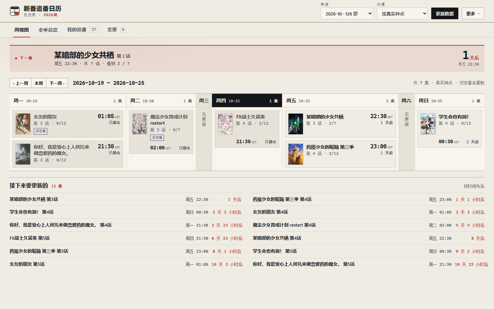
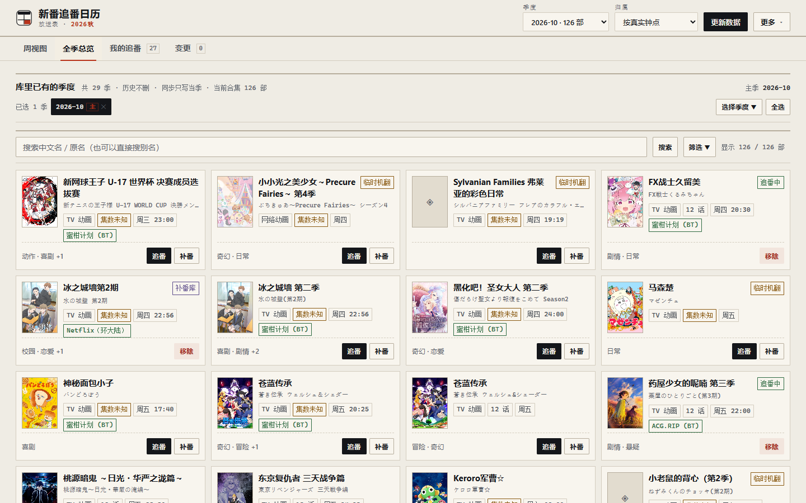
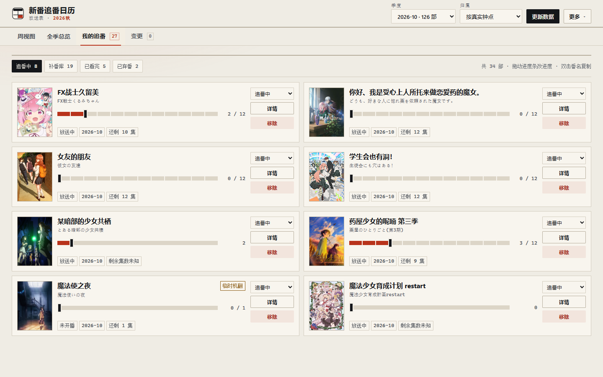
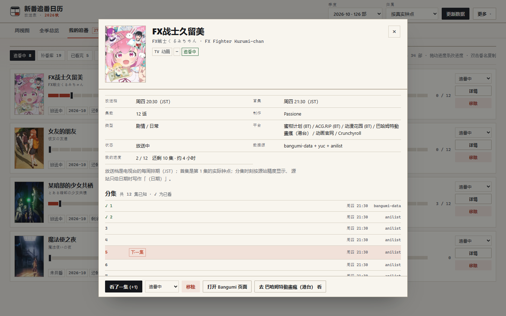
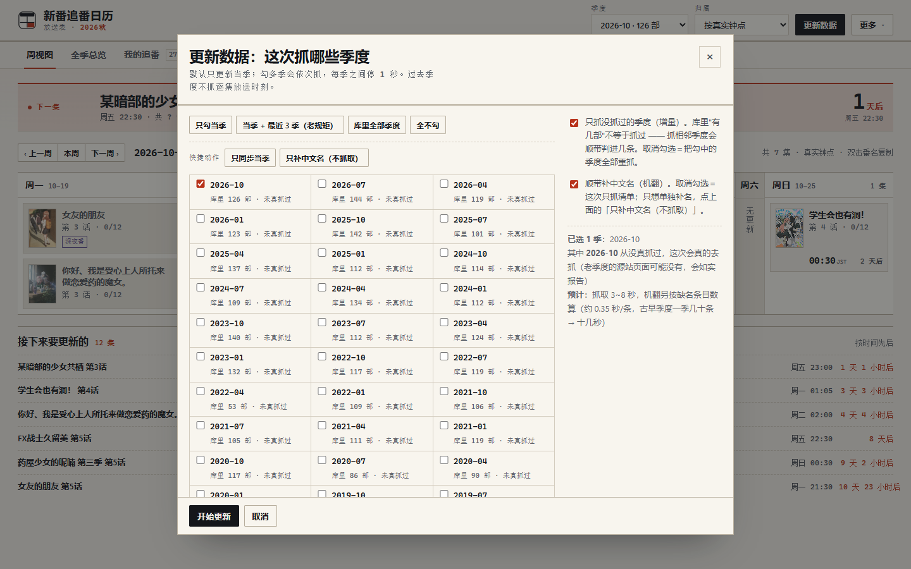
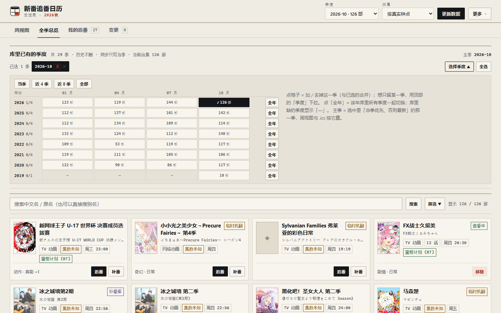
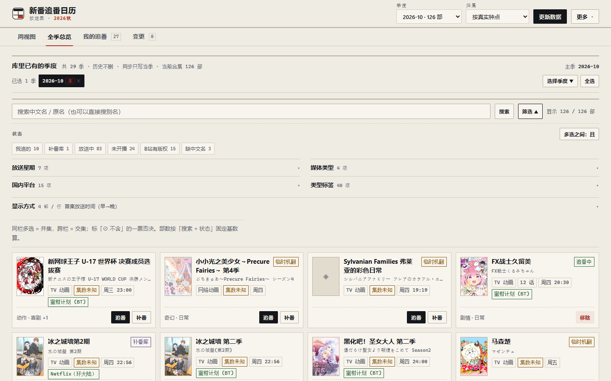

# 新番追番日历

<p align="center"></p>

**当季新番自动汇总 · 追番进度管理 · 每周更新日历 · 补番库**

一个在自己电脑上跑的小网页：把每季新番的**中文名、放送时间、在哪个平台能看**汇总到一起，
再帮你记「这部我看到第几集了」。数据全部存在你自己的电脑里，不用注册账号，也没有云端同步。



---

## 它解决什么问题

每季新番有一百多部，信息散落在好几个地方：**中文名在一个站、几点播在另一个站、
国内哪个平台能看在第三个地方**。想知道「这周我追的番分别哪天几点更新」，
通常要开好几个页面自己拼，拼完还得自己记看到第几集了。

这个工具把这些信息抓下来合成一份本地清单，然后回答五个问题：

| 你想知道 | 打开哪个页面 |
|---|---|
| 这季都有什么番？ | **全季总览**（可按放送星期 / 类型 / 平台筛选，可同时看几季） |
| 这周我追的番几点更新？ | **周视图**（带倒计时，还能导出到手机日历） |
| 我每部看到第几集了？ | **我的追番**（拖进度条就行，会自动记住） |
| 上一季没看完的番去哪了？ | **补番库**（自动归档，随时能翻出来继续看） |
| 有没有番改档、延期了？ | **变更**（每次更新时自动和上次对比） |

还有一个很多人踩过的坑它顺手处理了：日本电视台把深夜番写成「周日 24:30」，
其实是**周一凌晨 0:30**。本项目同时保留「放送日历上的星期」和「真实钟点」两种口径，
页面上可以随时切换，不会整体错位一天。

---

## 界面预览

**全季总览** —— 一季一百多部，按放送时间排；搜索、筛选、换季度都在这页。



**我的追番** —— 四个分类（追番中 / 补番库 / 已看完 / 已弃番）+ 可拖动的进度刻度。



**番剧详情** —— 每一集的确切放送时刻，以及每个字段是从哪个数据源来的；
数据源打架时会标出来。



**更新数据** —— 自己勾要抓哪些季度；默认只抓当季，也可以补以前缺的季度。



**选季度** —— 按「年 × 月」排的矩阵，一眼看出库里有哪些季度、各多少部、缺了哪一季。



**筛选** —— 放送星期、媒体类型、国内平台、类型标签四个维度，可以同时多选和排除。



---

## 下载与安装

### 你需要什么

- **一台 Windows 电脑**（Windows 10 / 11 都可以）
  - macOS、Linux 也能跑，但没有做桌面快捷方式，需要手动开命令行启动
- **Node.js**：版本 **22.18 或更新**（[官网下载](https://nodejs.org/)，选 LTS 装就行，一路下一步）
- 能上网（更新数据时要访问几个番剧资料站）

### 第一步：把项目下载到电脑

**方式 A（最简单）**：打开 <https://github.com/xiaotie3088/anime-tracker> →
点绿色的 **Code → Download ZIP** → 解压到一个**路径里不要有中文和空格**的地方，
比如 `D:\anime-tracker`。

**方式 B（会用 Git 的话）**：

```bash
git clone https://github.com/xiaotie3088/anime-tracker.git
```

> 建议把项目放在一个固定位置、以后不要随便移动 —— 桌面快捷方式会记住这个位置。

### 第二步：装依赖（只做一次）

打开项目文件夹，在地址栏输入 `cmd` 回车（这样打开的命令行就在当前目录），然后输入：

```bat
npm install
```

看到一堆 `added ... packages` 就成功了。

> 如果你已经装了 pnpm，`pnpm install` 也一样。
> 这一步是**必须**的：不做的话，启动时会报 `Cannot find package 'zod'`。

---

## 运行

### 方法一：双击桌面图标（推荐，仅 Windows）

1. 打开项目里的 `desktop` 文件夹
2. 双击 **`创建桌面快捷方式.cmd`**
3. 桌面上会出现一个「新番追番日历」图标 —— 以后双击它就行

双击后没有黑窗口弹出是正常的：它会在后台启动服务，等一两秒自动打开浏览器。
（万一浏览器没打开，看下面的「常见问题」。）

### 方法二：命令行启动

在项目文件夹里打开命令行，执行：

```bat
node src/server/server.ts
```

看到 `http://127.0.0.1:8787` 就说明起来了，浏览器打开这个地址即可。

### 第一次使用

1. 打开页面后，右上角点 **「更新数据」**
2. 默认只勾了**当季**，直接点 **「开始更新」** 就行（抓一季大约十几秒到一分钟）
3. 抓完后回到「全季总览」，看到列表就说明成功了
4. 想追某部番：在卡片右下角点 **「追番」**（或者「补番」先放进补番库）

### 怎么关掉它

- **停止服务**：页面右上角 **「更多 → 停止服务」**（下次双击桌面图标重新启动）
- **重启服务**：改了程序文件，或者页面卡住了，用 **「更多 → 重启服务」**，页面会自动刷新
- 直接关掉浏览器标签页**不会**停止服务，服务还在后台跑着

---

## 功能说明

### 周视图（默认页）

- 页首是「**下一集**」横条：最快要更新的那一集，带大号倒计时
- 下面按周一到周日排开：**当天有几集就占多宽**，没有更新的天压成一条竖排的「无更新」
- 今天那一列的表头会反色，一眼能认出来
- 左上角可以切「**上一周 / 本周 / 下一周**」
- 右上角「**归属**」下拉切换两种口径：
  - **按真实钟点**：周一 00:30 就排在周一
  - **按日本放送日历**：同样一集排在周日（和日本节目表一致）
- 鼠标**双击番名**可以直接复制
- 页尾「接下来要更新的」是未来一段时间的清单

### 全季总览

- 顶部是季度区：平时只占一行（已选的季度 + 「选择季度」+「全选」），点开是「年 × 月」矩阵
  - 可以同时选几季一起看（比如同时看 7 月和 10 月）
  - 「当季 / 近 4 季 / 近 8 季 / 全部」是快捷预设
- 搜索框：输入中文名、原名或别名，**点「搜索」或按回车**才筛（边打字边筛会很卡）
- 「筛选」面板（默认收起）：
  - 四个维度：**放送星期**、**媒体类型**（TV / 剧场版 / OVA…）、**国内平台**、**类型标签**
  - 同一维度多选是「或」，不同维度之间是「且」，还能对某个条件选「不含」
  - 每个选项后面标着有几部，方便先看分布
  - 「显示方式」里可以改排序和**每行显示几部（3～7）**
- 卡片左下角「追番 / 补番」一键加入；已经在追的卡片会显示「移除」

### 我的追番 / 补番库

- 四类：**追番中 / 补番库 / 已看完 / 已弃番**，点上方标签切换
- **拖进度条**：进度条就是一集一格，拖完松手才保存（拖的时候不会反复写库）
- 卡片上的下拉框可以把番**移到任意分类**（比如看完了移到「已看完」）
- 「详情」按钮打开详情卡；「移除」把它从列表里去掉
- **双击番名可以复制**番名
- 补番库会显示「还剩 N 集 / 大约多少小时」，方便安排补番

### 番剧详情

- 每一集的**确切放送时刻**、已经看到第几集
- 每个字段后面标着**数据来源**（哪个站提供的中文名 / 时刻 / 海报）
- 数据源之间对不上时会标「**源有分歧**」；你手动改过的会标「**手动修正**」
- 底部按钮：看完一集（+1）、移到别的分类、移除、打开 Bangumi / 巴哈姆特页面

### 变更（延期 / 改档）

- 每次「更新数据」后，会自动把新抓到的放送时间和库里的历史对比
- 只有**真正改了时间**的才会记一条：源站切换、几十秒的抖动会被自动过滤，不会天天报假警
- 列表里点「详情」能看到原来是几点、改成了几点

### 更新数据

- 点「更新数据」会弹出季度选择框：
  - **只勾当季**（默认）：最快，日常用这个
  - **当季 + 近 3 季**：顺手补一补前面的
  - **库里全部季度**：第一次用、或者想重建整个库
  - 也可以在「年 × 月」矩阵里**自己勾任意季度**（包括库里还没有的老季度）
- 两个选项：
  - **只抓没抓过的季度（增量）**：默认勾着，抓过的季度会跳过
  - **顺带补中文名（机翻）**：官方没有中文名的番，先用机器翻译顶上，界面上会标「临时机翻」，
    以后官方译名出现了会自动替换
- 任务跑起来后右上角会出现「**停止**」按钮；已经抓到的数据不会丢

### 导出

- **导出日历 (.ics)**：在「更多」里。下载后导入手机日历，之后不打开这个网页也能看到更新时间
- **导出我的数据**：把追番列表、每部看到第几集、手动修正、变更记录导出成 JSON 文件 ——
  这些是**无法重新抓取**的数据，建议隔一段时间导一份留底

### 主题

「更多 → 主题」可以选 **跟随系统 / 浅色 / 深色**，选完会记住。

---

## 数据与隐私

- 所有数据都在项目文件夹的 **`data\anime.db`** 这一个文件里
- **自动备份**：启动服务时、每次更新数据之前，都会备份到 `data\backups\`，只保留最近 20 份
- 除了抓番剧资料和翻译之外，**不会向任何服务器发送你的数据**；没有账号、没有统计、没有云同步
- 服务只监听 `127.0.0.1`（只有本机能访问），同一局域网里的其他设备也连不上

**怎么恢复备份**：先「停止服务」，把 `data\backups\` 里最新的一份复制回
`data\anime.db`（连同 `-wal`、`-shm` 两个文件一起），再启动服务。

> ⚠ 备份一定要连 `anime.db-wal`、`anime.db-shm` 一起复制，只拷主文件可能丢追番列表。

---

## 常见问题

**桌面图标是一张白纸 / 不是日历图标**
重新双击一次 `desktop\创建桌面快捷方式.cmd`。脚本会把图标复制到
`%LOCALAPPDATA%\anime-tracker\` 再给快捷方式用，并主动清一次图标缓存。
如果还是白纸，注销一次 Windows 再登录。

**双击桌面图标没反应 / 浏览器没打开**
双击 `desktop\start-anime-calendar-debug.cmd`（可见黑窗口、报错直接显示）。
也可以看日志：`data\launcher.log`。

**双击时报「打开文件 - 安全警告」**
那是 Windows 给从网上下载的文件加的标记。右键文件 → 属性 → 勾选「解除锁定」，
或者重跑一次创建快捷方式的脚本（脚本会自动解除）。

**提示 `Cannot find package 'zod'`**
还没装依赖，回到项目文件夹执行一次 `npm install`。

**抓数据很慢 / 抓不到**
- 番剧资料站（Bangumi）在国内可能需要代理：命令行先设
  `set HTTPS_PROXY=http://127.0.0.1:7890`（端口换成你自己的代理）再启动
- 抓一季通常十几秒到一分钟，机器翻译会慢一些，属正常

**页面打不开 / 端口被占用**
看看是不是已经有一个服务在跑了（重新双击桌面图标即可），
或者在「更多 → 重启服务」。

**换电脑 / 换文件夹**
把整个项目文件夹（包括 `data\` 和 `node_modules\`）复制过去，重新跑一次
`desktop\创建桌面快捷方式.cmd`。快捷方式记录的是文件夹路径，移动过位置就要重建。

**能不能在手机上看？**
服务只在本机监听。想在手机上看更新，用「导出日历 (.ics)」导入手机日历最省事。

---

## 数据来源与致谢

番剧资料来自这几个公开站点，本工具只是把它们整理到一起：

- [bangumi-data](https://github.com/bangumi-data/bangumi-data) —— 中文名、放送时间
- [yuc.wiki](http://yuc.wiki) —— 人工校对过的当季排期
- [AniList](https://anilist.co) —— 每集精确时刻、类型标签、海报
- 缺中文名时的机翻由 Bing 提供

海报与番剧信息的版权属于各自的权利方，本项目只做个人观看计划的整理，不提供播放。

---

## 给想改代码的人

- **没有构建步骤**：Node 22.18+ 直接跑 `.ts`，改完重启服务就生效
- 运行时依赖只有 `zod` 和 `undici`；界面是一个页面 + 一个 `app.js`，没有前端框架
- 目录：

```
src/core/       时间与深夜番归属、日历分组、补番规则、多源融合
src/providers/  bangumi-data / yuc / AniList / Bing 机翻
src/server/     SQLite 读写、抓取落库、HTTP 接口、命令行
web/            原生 ES 模块界面（index.html + styles.css + app.js）
desktop/        Windows 启动器、快捷方式、图标
scripts/        自检脚本
docs/           开发交接文档、决策记录、数据源实测
```

- 自检：

```bash
npm run typecheck     # 类型检查
npm run verify        # 离线自检（不需要联网）
npm run verify:api    # 接口自检（需要服务已启动，会写测试数据）
```

开发相关的坑、硬约束与待办，都写在 [`docs/交接说明-第四轮.md`](docs/交接说明-第四轮.md)。

---

## 许可

尚未指定开源许可证。个人自用没问题；如果你想把它分发或用在别处，欢迎先开个 Issue 说一声。
